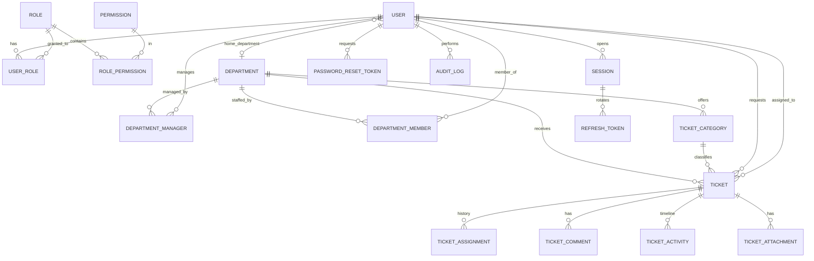

# WorkDesk — Architecture Notes (v0.2)

Single-tenant helpdesk and service request system.
Stack: Next.js (App Router, TypeScript) · NestJS (TypeScript) · PostgreSQL · Prisma.
Companion files: `apps/api/prisma/schema.prisma`, `apps/api/prisma/sql/db_hardening.sql`.

---

## 1. Decisions locked so far

| Topic | Decision |
|---|---|
| Tenancy | Single organization. No `organization_id` anywhere. |
| Roles | Seeded starting roles (System Administrator, Support Manager, Support Agent, Employee, Auditor). Roles are data. No code branches on role names. |
| Auth | Short-lived JWT access token (in memory) + rotating refresh token in an httpOnly cookie. |
| Sessions | Server-side `sessions` + `refresh_tokens` tables. Refresh tokens stored only as SHA-256 hashes. |
| Authorization | Three layers: permission (RBAC), scope (department / ownership), business state (ticket state machine). |
| ORM | Prisma (schema delivered in Prisma format; the assignment allows it). |

---

## 2. MVC mapping

NestJS is modular and layered rather than textbook MVC, so here is exactly how the three letters map. Use this table in the review when asked about architecture.

| MVC | Where it lives | What it does |
|---|---|---|
| **Model** | `schema.prisma`, Prisma client, repository classes, domain rules inside services | Data, relationships, constraints, state machine rules |
| **View** | The entire Next.js app (pages, layouts, components). On the API side, response DTOs are the "view" of a record | What the user sees. API responses are shaped by response DTOs so internals (password hash, token hashes) can never leak |
| **Controller** | NestJS controllers (thin) + services (the business logic they call) | Controllers only parse the request, apply guards and call a service. They contain no business rules |

Rule of thumb for the codebase: **controller = HTTP, service = decisions, repository = SQL.** A controller never touches Prisma directly.

---

## 3. Repository structure (monorepo)

> **Backend layout superseded.** The backend now lives at the repository root in the folder layout described in `docs/BACKEND_SETUP.md` ("Where things go"): `server.ts`, `src/app.ts`, `src/controller`, `src/service`, `src/middleware`, `src/models`, `src/utilities`, `src/config`, `src/tests`. The `apps/api` tree below is the original proposal. The `apps/web` and `packages/shared` parts still apply when the frontend is built.

```
workdesk/
├── docker-compose.yml
├── .env.example
├── README.md
├── docs/
│   ├── architecture.md
│   └── erd.md
├── apps/
│   ├── api/                              # NestJS
│   │   ├── prisma/
│   │   │   ├── schema.prisma
│   │   │   ├── migrations/               # includes the hand-written SQL migration
│   │   │   └── seed.ts                   # permissions, roles, departments, demo users, tickets
│   │   ├── src/
│   │   │   ├── main.ts                   # helmet, CORS, cookie-parser, ValidationPipe, Swagger
│   │   │   ├── app.module.ts
│   │   │   ├── config/                   # typed env config + validation (fail fast on missing secrets)
│   │   │   ├── prisma/                   # PrismaModule / PrismaService
│   │   │   ├── common/
│   │   │   │   ├── decorators/           # @RequirePermissions, @CurrentUser, @Public
│   │   │   │   ├── guards/               # JwtAuthGuard, PermissionsGuard
│   │   │   │   ├── filters/              # global exception filter (no stack traces to clients)
│   │   │   │   ├── interceptors/         # audit + request-id interceptor
│   │   │   │   ├── pipes/
│   │   │   │   └── dto/                  # pagination, id params
│   │   │   └── modules/
│   │   │       ├── auth/                 # controller, service, strategies, token + session services
│   │   │       ├── users/
│   │   │       ├── roles/
│   │   │       ├── permissions/          # read-only catalogue
│   │   │       ├── departments/          # departments, managers, members
│   │   │       ├── categories/
│   │   │       ├── tickets/              # controller, service, repository, state-machine, scope
│   │   │       │   ├── ticket-scope.service.ts
│   │   │       │   ├── ticket-state-machine.ts
│   │   │       │   └── dto/
│   │   │       ├── assignments/
│   │   │       ├── comments/
│   │   │       ├── activity/
│   │   │       ├── dashboard/            # permission-aware widgets
│   │   │       ├── reports/
│   │   │       ├── audit-logs/
│   │   │       └── settings/
│   │   └── test/                         # unit + e2e (auth, RBAC, IDOR, state machine)
│   └── web/                              # Next.js
│       ├── src/
│       │   ├── app/
│       │   │   ├── (auth)/login, forgot-password, reset-password
│       │   │   └── (app)/                # protected layout
│       │   │       ├── dashboard/
│       │   │       ├── tickets/, tickets/new, tickets/[id]
│       │   │       ├── queue/            # department review queue
│       │   │       ├── users/, roles/, permissions/
│       │   │       ├── departments/
│       │   │       ├── reports/, audit-logs/, settings/, profile/
│       │   ├── components/               # ui kit, tables, forms
│       │   ├── features/                 # per-module hooks, api calls, schemas
│       │   ├── lib/
│       │   │   ├── api-client.ts         # attaches access token, single-flight refresh on 401
│       │   │   ├── auth-context.tsx      # user + permissions in memory
│       │   │   └── permissions.ts        # usePermission(), <Can>, nav config
│       │   └── middleware.ts             # optional UX redirect only, not security
└── packages/
    └── shared/                           # permission keys + shared enums (single source of truth)
```

`packages/shared` holds the permission key constants and status enums so the API and the web app can never drift.

---

## 4. Authorization pipeline (every protected request)

```
Request
  1. JwtAuthGuard          verify signature/expiry, read sub + sid
  2. Session check         session exists, not revoked, not expired, user ACTIVE
  3. PermissionsGuard      effective permissions (union over active roles) contain the required key
  4. Scope (service layer) query is filtered so the user can only reach records in their scope
  5. State machine         requested transition is legal from the ticket's current status
  6. Audit / activity      privileged action recorded
```

Why steps 3 and 4 are separate: `tickets.view_assigned` says you may use the "my assignments" feature. It says nothing about which ticket id you may open. Scope decides that. A ticket outside the caller's scope returns **404** (not 403) so ids cannot be probed.

---

## 5. Authentication and session design

### 5.1 Tokens

| Token | Lifetime | Where it lives | Contents |
|---|---|---|---|
| Access JWT | 10 to 15 min | JS memory only (never localStorage) | `sub` (user id), `sid` (session id), `iat`, `exp`. **No permissions** inside, so permission changes cannot go stale in a token |
| Refresh token | 7 days sliding, rotated on every use | httpOnly cookie | 256-bit random string. DB stores only its SHA-256 hash |
| Session | 30 days absolute cap | `sessions` row | Survives rotation. Expires regardless of activity |

Why SHA-256 for refresh tokens but argon2id for passwords: the token is 256 bits of randomness, so a fast hash is safe and lets us look it up by hash with a unique index. Passwords are low-entropy and need a slow, salted hash.

### 5.2 Cookie

`refresh_token`, `HttpOnly`, `Secure` (off only in local dev), `SameSite=Strict`, `Path=/api/auth` so the browser sends it only to auth endpoints. Serve the API through the Next.js origin (rewrite `/api/*`) so cookie and app are same-site. Add an `Origin` check on `/auth/refresh` and `/auth/logout` as CSRF defence in depth.

**Persistence across page refreshes** (assignment 3.1, item 5): the access token lives only in memory, so a reload loses it. On app start the web client calls `POST /auth/refresh` once; if the cookie is valid it receives a new access token, then loads `/auth/me` (user + effective permissions) before rendering protected routes. A failed refresh sends the user to the login page.

### 5.3 Login

1. Normalize email to lowercase, find user. Always run a password verification (against a dummy hash if the user is missing) to keep timing uniform.
2. Reject if `status != ACTIVE` or `lockedUntil > now()`, with the same generic "invalid credentials" message.
3. Wrong password: increment `failed_login_count`; at 5 failures set `locked_until = now()+15min`. `status` stays `ACTIVE`, so the lock expires by itself and an admin can clear it early by resetting the counter. Write a `login_attempts` row and an audit log entry. Also rate-limit per IP with `@nestjs/throttler`.
4. Success: reset counters, create `sessions` row, create first `refresh_tokens` row, set cookie, return access token + user + effective permissions.

### 5.4 Refresh rotation with reuse detection

On `POST /auth/refresh`:

1. Hash the cookie value and look up `refresh_tokens.token_hash`.
2. Unknown, expired or revoked: 401, clear cookie.
3. **`used_at` already set (a rotated token is being replayed):** assume theft. Revoke the whole session (`revoked_reason = REFRESH_REUSE_DETECTED`), write an audit entry, return 401. Allow a ~10 second grace window so two browser tabs refreshing at once do not kill a legitimate session.
4. Otherwise, in one transaction: mark the presented token `used_at = now()`, insert a new token, link `replaced_by_id`, bump `sessions.last_used_at`, return a fresh access token and set the new cookie.

### 5.5 Revocation and stale authorization

| Event | Effect |
|---|---|
| Logout | Session revoked (`LOGOUT`), cookie cleared |
| Logout everywhere / password change / reset | All the user's sessions revoked |
| Admin deactivates user | `status = INACTIVE`, all sessions revoked (`USER_DEACTIVATED`). Next API call fails at step 2 of the pipeline immediately, not after the access token expires |
| Role or permission change | Effective permissions are resolved server-side per request (optionally from a short in-process cache that the role/permission services explicitly invalidate). The frontend re-fetches `/auth/me` on focus and on any 403 |

Because the guard checks the session row on every request, deactivation and revocation are effective instantly (assignment scenario 8). Because permissions are resolved per request instead of being stored in the token, removing a permission from a role takes effect on that user's very next call (scenario 7).

### 5.6 Safeguards

- The last active user holding `roles.assign_permissions` + `users.assign_roles` cannot be deactivated or stripped of those roles (prevents locking everyone out).
- A user cannot change their own roles, and cannot grant a permission they do not themselves hold.
- Seeded roles (`is_system`) cannot be deleted.
- DTOs use `whitelist: true, forbidNonWhitelisted: true` (mass-assignment protection). `status`, `requesterId`, `assignedAgentId` and similar fields are never accepted from a client-supplied body unless that endpoint is explicitly allowed to set them.

---

## 6. Schema overview



### Table groups

| Group | Tables | Notes |
|---|---|---|
| Identity and RBAC | `users`, `roles`, `permissions`, `user_roles`, `role_permissions` | Composite primary keys on the join tables prevent duplicate grants and carry who/when for accountability |
| Sessions and credentials | `sessions`, `refresh_tokens`, `password_reset_tokens`, `login_attempts` | Only hashes stored. `login_attempts` has no FK so unknown-email attempts are still logged |
| Organization | `departments`, `department_managers`, `department_members` | A department holds 1 to 3 managers (limit read from `application_settings`). `users.department_id` is only the person's home department and never limits what they can request |
| Tickets | `ticket_categories`, `tickets`, `ticket_assignments`, `ticket_comments`, `ticket_activity`, `ticket_attachments` | Assignment history is append-only; `tickets.assigned_agent_id` is the denormalized current assignee for fast queries |
| System | `audit_logs`, `application_settings` | Audit log is append-only (database trigger) |

### Design notes worth defending in the review

- **Two logs, two purposes.** `ticket_activity` is the business timeline users see. `audit_logs` is the security trail admins and auditors review (role changes, denied access, session revocations).
- **Requester snapshot.** `requester_department_id` and `requester_snapshot` freeze who asked and with what roles at submission time, as the note requires reviewers to see.
- **`status` stored once.** The `Submitted` state from the note is recorded as the `SUBMITTED` activity event; the ticket itself starts at `PENDING_REVIEW`. Mapping to the PDF's labels: New = `PENDING_REVIEW`, Open = `ACCEPTED`/`ASSIGNED`/`REOPENED`.
- **Soft delete only where needed:** users, tickets, comments. Everything else uses `is_active` or hard FK rules (`Restrict` where history would break).
- **Permissions are seeded; roles are not hardcoded.** A permission only means something if code enforces it, so the catalogue ships with the code and admins view it and assign it to roles (the assignment allows a seeded catalogue, section 3.3). Roles, role-to-permission links and user-to-role links are all admin-editable data.
- **Seed vs. live demo.** Seed `Auditor` as the sample role and leave the name `Read-Only Auditor` unused. Assignment scenario 2 creates that role live, and role names are unique.
- **Naming.** The assignment and the product note call tickets "service requests" (`Service_Requests`, `Request_Comments`, `Request_Activity`). The schema uses `tickets` and `ticket_*`, and the UI label is "Service Requests". Be ready to explain this mapping in the review.

---

## 7. Scope rules and ticket state machine

### 7.1 Ticket visibility scope (computed by `TicketScopeService`)

A user's visible tickets are the **union (OR)** of the scopes granted by the permissions they hold.

| Permission held | Tickets visible |
|---|---|
| `tickets.view_all` | all non-deleted tickets |
| `tickets.view_department` | tickets whose `department_id` is in the user's `department_managers` rows |
| `tickets.view_assigned` | tickets where `assigned_agent_id = me` |
| `tickets.view_own` | tickets where `requester_id = me` |

Every read and every mutation goes through this scope. A mutation needs the **permission AND visibility**. This is why demonstration scenario 4 works: the auditor holds `tickets.view_all`, so once `tickets.assign` is added the assignment action becomes available on any visible ticket, still subject to the state machine and the "assignee must be a member of the destination department" rule. The same rule lets a System Administrator (who holds `tickets.view_all`) act on any department queue without being listed as its manager.

`WORK_NOTE` comments are returned only to users who can see the ticket through a staff scope, never to a requester who only holds `view_own`.

### 7.2 State machine (enforced in `ticket-state-machine.ts`)

| From | To | Required permission | Rules |
|---|---|---|---|
| `PENDING_REVIEW` | `ACCEPTED` | `tickets.accept` | ticket is within the caller's scope (7.1) |
| `PENDING_REVIEW` | `REJECTED` | `tickets.reject` | reason mandatory |
| `PENDING_REVIEW` | `CLARIFICATION_REQUESTED` | `tickets.request_clarification` | question recorded as a `CLARIFICATION` comment |
| `CLARIFICATION_REQUESTED` | `PENDING_REVIEW` | requester (`tickets.update_own`) | requester replied |
| `PENDING_REVIEW`, `CLARIFICATION_REQUESTED`, `ACCEPTED` | `CANCELLED` | requester (`tickets.update_own`) | before work starts |
| `ACCEPTED` | `ASSIGNED` | `tickets.assign` | assignee active, member of the department |
| `ASSIGNED` | `IN_PROGRESS` | `tickets.change_status` | assigned agent |
| `ASSIGNED`/`IN_PROGRESS` | same status, new agent | `tickets.assign` | reassignment, reason mandatory, closes the current assignment row |
| `IN_PROGRESS` | `RESOLVED` | `tickets.resolve` | resolution text mandatory |
| `RESOLVED` | `CLOSED` | `tickets.close` | optionally after requester confirmation (open decision) |
| `RESOLVED`, `CLOSED` | `REOPENED` | `tickets.reopen` | increments `reopen_count`, reason recorded |
| `REOPENED` | `ASSIGNED`/`IN_PROGRESS` | `tickets.assign` / `tickets.change_status` | |
| Pre-resolution states | new department | `tickets.transfer_department` | resets to `PENDING_REVIEW`, closes the current assignment |

`REJECTED` and `CANCELLED` are terminal. Any transition not in this table returns 409/422 and is not written.

---

## 8. Raw SQL migration (things Prisma cannot express)

The SQL below is also saved as `apps/api/prisma/sql/db_hardening.sql`. Create the migration with `npx prisma migrate dev --create-only --name db_hardening`, paste the file's contents into it, then apply. After applying, run `npx prisma migrate dev` once more and confirm it proposes no drop of these indexes; Prisma cannot model partial or trigram indexes, so if it does, keep them in a post-migrate step instead.

```sql
-- Emails are stored lowercase
ALTER TABLE users ADD CONSTRAINT users_email_lowercase CHECK (email = lower(email));

-- Exactly one current assignment per ticket
CREATE UNIQUE INDEX ticket_assignments_one_current
  ON ticket_assignments (ticket_id) WHERE unassigned_at IS NULL;

-- Rejected tickets must carry a reason; resolved tickets must carry a resolution
ALTER TABLE tickets ADD CONSTRAINT tickets_rejection_reason_required
  CHECK (status <> 'REJECTED' OR rejection_reason IS NOT NULL);
ALTER TABLE tickets ADD CONSTRAINT tickets_resolution_required
  CHECK (status NOT IN ('RESOLVED','CLOSED') OR resolution IS NOT NULL);

-- Fast lookups for live credentials only
CREATE INDEX refresh_tokens_live_idx
  ON refresh_tokens (session_id) WHERE used_at IS NULL AND revoked_at IS NULL;
CREATE INDEX sessions_live_idx
  ON sessions (user_id) WHERE revoked_at IS NULL;

-- Fuzzy title search for ticket lists
CREATE EXTENSION IF NOT EXISTS pg_trgm;
CREATE INDEX tickets_title_trgm_idx ON tickets USING gin (title gin_trgm_ops);

-- Append-only audit log
CREATE OR REPLACE FUNCTION audit_logs_immutable() RETURNS trigger AS $$
BEGIN
  RAISE EXCEPTION 'audit_logs is append-only';
END;
$$ LANGUAGE plpgsql;

CREATE TRIGGER audit_logs_no_update_delete
  BEFORE UPDATE OR DELETE ON audit_logs
  FOR EACH ROW EXECUTE FUNCTION audit_logs_immutable();
```

Housekeeping job (NestJS `@Cron`): delete expired `refresh_tokens`, `password_reset_tokens`, old revoked `sessions`, and `login_attempts` older than 30 days.

Effective permissions query (the heart of RBAC):

```sql
SELECT DISTINCT p.key
FROM user_roles ur
JOIN roles r             ON r.id = ur.role_id AND r.is_active
JOIN role_permissions rp ON rp.role_id = r.id
JOIN permissions p       ON p.id = rp.permission_id
WHERE ur.user_id = $1;
```

---

## 9. Permission catalogue (seeded)

The union of the PDF and the product note, plus a few additions the design needs (marked ★).

| Module | Keys |
|---|---|
| users | `users.view` `users.create` `users.update` `users.delete` `users.activate` `users.assign_roles` ★`users.revoke_sessions` |
| roles | `roles.view` `roles.create` `roles.update` `roles.delete` `roles.assign_permissions` |
| permissions | ★`permissions.view` |
| departments | `departments.view` `departments.create` `departments.update` `departments.manage_members` |
| categories | ★`categories.view` ★`categories.manage` |
| tickets | `tickets.create` `tickets.view_own` `tickets.view_assigned` `tickets.view_department` `tickets.view_all` `tickets.update_own` `tickets.update_assigned` `tickets.assign` `tickets.change_priority` `tickets.change_status` `tickets.accept` `tickets.reject` `tickets.request_clarification` `tickets.resolve` `tickets.close` `tickets.reopen` `tickets.transfer_department` `tickets.delete` ★`tickets.comment` ★`tickets.view_work_notes` |
| reports | `reports.view` `reports.export` |
| audit | `audit_logs.view` |
| settings | ★`settings.view` ★`settings.update` |

Default seeded role bundles:

| Role | Permissions |
|---|---|
| System Administrator | everything |
| Support Manager | `tickets.view_department` `tickets.accept` `tickets.reject` `tickets.request_clarification` `tickets.assign` `tickets.change_priority` `tickets.transfer_department` `tickets.comment` `tickets.view_work_notes` `reports.view` `categories.view` (+ `categories.manage` optional) |
| Support Agent | `tickets.view_assigned` `tickets.update_assigned` `tickets.change_status` `tickets.resolve` `tickets.comment` `tickets.view_work_notes` |
| Employee | `tickets.create` `tickets.view_own` `tickets.update_own` `tickets.comment` `tickets.reopen` `categories.view` `departments.view` |
| Auditor (read-only) | `tickets.view_all` `reports.view` `audit_logs.view` |

---

## 10. Open decisions (current default in bold)

| # | Question | Default used until you decide |
|---|---|---|
| 1 | Is department membership mandatory for every user? | **No** (`users.department_id` nullable) |
| 2 | Can a manager assign agents outside their department? | **No**, assignee must be in `department_members` |
| 3 | Does closing need requester confirmation? | **No**, `tickets.close` holder closes; revisit |
| 4 | Do sensitive categories need an extra approval step? | **Flag only** (`is_sensitive`), approval workflow deferred |
| 5 | Max managers per department | **3**, configurable in `application_settings` |
| 6 | Does `tickets.view_department` also cover departments where the user is only a member? | **No**, managed departments only |
| 7 | Department-scoped categories or global? | **Per department** |

---

## 11. Suggested build order

1. Monorepo scaffold, Docker Compose, env validation.
2. Prisma schema, migration, hardening SQL, seed (permissions, roles, departments, demo users).
3. Auth module: login, refresh rotation, logout, `/auth/me`, lockout, reset flow, with tests.
4. Guards and decorators (`@RequirePermissions`), then users, roles, permissions modules.
5. Departments, categories, scope service.
6. Tickets, state machine, assignments, comments, activity.
7. Dashboard and reports, audit logs.
8. Frontend: auth context, permission utilities, protected layout, dynamic sidebar, then modules.
9. E2E tests for the eight demonstration scenarios, Swagger, README.

---

## 12. Deliverables checklist (assignment section 7)

| # | Deliverable | Status |
|---|---|---|
| 1 | Frontend source (Next.js) | Pending |
| 2 | Backend source (NestJS) | Pending |
| 3 | Database schema | **Done** (`schema.prisma`) |
| 4 | Migrations | Hardening SQL done; initial migration is generated by `prisma migrate dev` on first run |
| 5 | Seed data (users, roles, permissions, requests) | Pending |
| 6 | `.env.example` | Pending |
| 7 | README (install and setup) | Pending |
| 8 | Swagger / OpenAPI | Pending (wired in `main.ts`) |
| 9 | Automated tests (auth, roles, permissions, restricted endpoints) | Pending |
| 10 | Demo credentials for each initial role | Pending (seed output and README) |
| 11 | Architecture notes | **Done** (this file, draft) |
